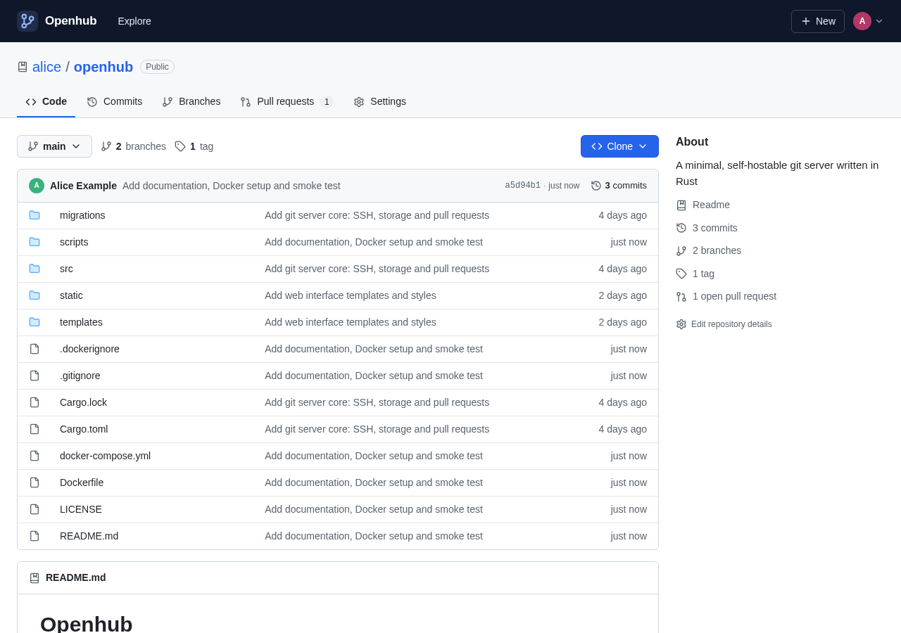
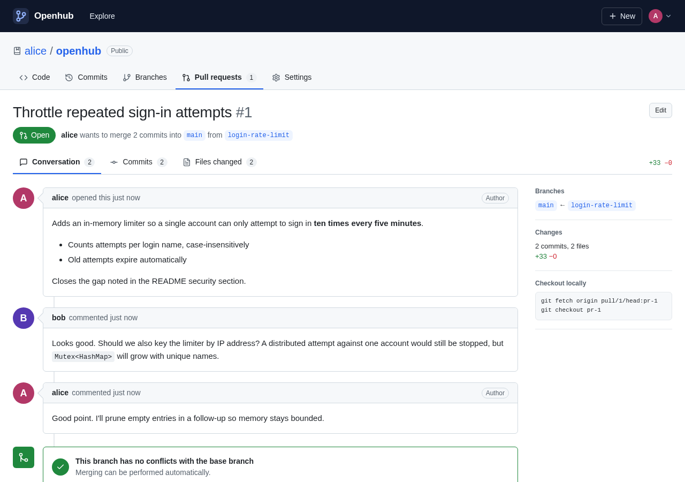
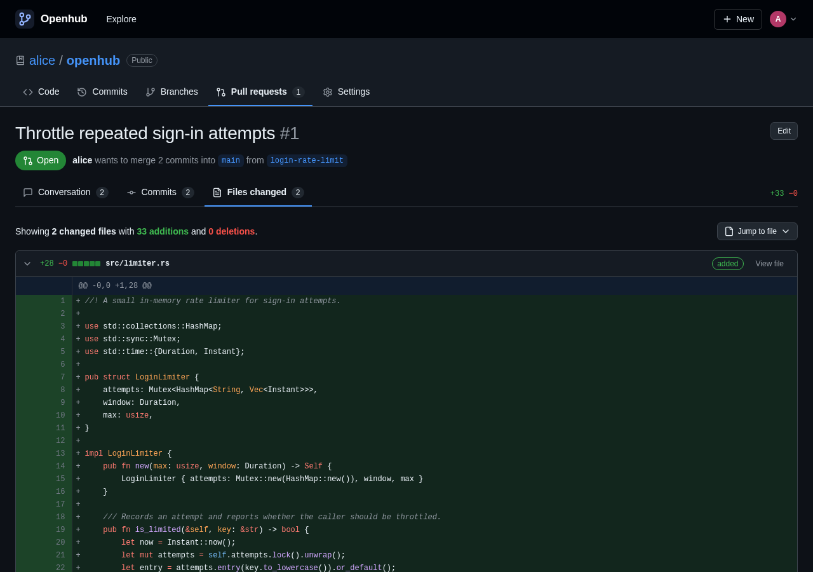

# Openhub

Openhub is a minimal, self-hostable git server with a familiar web interface. Push over SSH, browse code and history, and discuss and merge changes with pull requests. That is the whole product: no CI, no wiki, no forks.

It ships as a single Rust binary with SQLite for storage, so a whole installation is one executable plus one data directory.



## Features

- **Git over SSH**: a built-in SSH server authenticates `git push` and `git fetch` with the public keys users add in their settings. No system `sshd` configuration is needed.
- **Read-only git over HTTP**: anonymous clones and fetches of public repositories, and password-authenticated ones of private repositories. Pushing is SSH-only.
- **Code browsing**: file trees with the latest commit for each entry, syntax-highlighted files with linkable line numbers, rendered Markdown READMEs, raw files, and ZIP/tar.gz downloads.
- **History**: paginated commit logs (per branch, tag or path), commit pages with diffs, a branch list with ahead/behind counts against the default branch, and a tag list.
- **Pull requests**: compare branches, open a pull request, discuss it in Markdown comments, and review the commits and the diff. Merge with a merge commit, a squash or a rebase, then delete the branch. Pull requests merged with a plain `git push` are detected automatically, and a pull request can be closed without merging and reopened later.
- **Accounts and access**: public and private repositories, plus collaborators with write access. Each repository names its owner, may carry a short description and a default branch, and can be renamed or deleted from its settings. The first account created is the site administrator.
- **Comfortable to use**: light and dark themes, works on phone-sized screens, and needs no JavaScript for core features.

<table>
  <tr>
    <td></td>
    <td></td>
  </tr>
</table>

## Quick start

### With Docker

```sh
docker compose up -d
```

Open <http://localhost:3000> and create an account; the first account becomes the administrator. Before deploying, edit `OPENHUB_PUBLIC_URL` in `docker-compose.yml` to the URL people will use.

### From source

You need Rust 1.88 or newer, a C compiler (to build the bundled libgit2 and SQLite), and `git` installed at runtime.

```sh
cargo build --release
./target/release/openhub --public-url http://localhost:3000
```

By default the web interface listens on port `3000` and the SSH server on port `2222`. Everything is stored in `./data`. During development, `cargo run -- --data-dir ./data` starts the same server without a release build.

### On a Linux server with systemd

`scripts/deploy-server.sh` installs Openhub on a Linux machine as a systemd service, over SSH. It copies your checkout to the machine, builds it there (installing Rust with rustup the first time) and runs `packaging/linux/install.sh`. The machine needs `git`, `curl` and a C compiler, and your SSH user needs `sudo`.

```sh
scripts/deploy-server.sh user@host
```

The service runs as the `openhub` user, keeps its data in `/var/lib/openhub`, starts at boot and restarts whenever it stops. The web interface listens on `127.0.0.1:3000` for a reverse proxy or tunnel on the same machine. SSH listens on port `2222` on every interface. Put your settings in `/etc/default/openhub`, then run `sudo systemctl restart openhub`:

```sh
OPENHUB_PUBLIC_URL=https://git.example.com
OPENHUB_DISABLE_REGISTRATION=true
```

To upgrade, run the same command again. See [Operations → Running under systemd](docs/operations.md#running-under-systemd).

## Pushing your first repository

1. Sign in and open **Settings → SSH keys**. Paste your public key, for example the contents of `~/.ssh/id_ed25519.pub`.
2. Check that the server accepts the key:
   ```sh
   ssh -T -p 2222 git@your-host
   # Hi alice! You've successfully authenticated, but Openhub does not provide shell access.
   ```
3. Create a repository with **New**, then push to it:
   ```sh
   git remote add origin ssh://git@your-host:2222/alice/project.git
   git push -u origin main
   ```

When you push a branch other than the default branch, the server prints a link for opening a pull request. Once a pull request exists, the link points to it instead.

## Configuration

Each option can be set as a command-line flag or as an environment variable.

| Flag | Environment variable | Default | Description |
| --- | --- | --- | --- |
| `--data-dir` | `OPENHUB_DATA_DIR` | `./data` | Holds the database, repositories and SSH host key |
| `--http-addr` | `OPENHUB_HTTP_ADDR` | `0.0.0.0:3000` | Listen address for the web interface |
| `--ssh-addr` | `OPENHUB_SSH_ADDR` | `0.0.0.0:2222` | Listen address for the SSH server |
| `--public-url` | `OPENHUB_PUBLIC_URL` | `http://localhost:3000` | External URL of the web interface, used for links and clone URLs |
| `--ssh-host` | `OPENHUB_SSH_HOST` | host of the public URL | Host shown in SSH clone URLs |
| `--ssh-port` | `OPENHUB_SSH_PORT` | the SSH listen port | Port shown in SSH clone URLs |
| `--disable-registration` | `OPENHUB_DISABLE_REGISTRATION` | `false` | Turns off sign-ups (the first account can still be created) |
| `--git-bin` | `OPENHUB_GIT_BIN` | `git` | Path to the `git` executable |

Logging is controlled with `RUST_LOG`, for example `RUST_LOG=openhub=debug`.

## Deployment notes

- **HTTPS**: put Openhub behind a reverse proxy such as Caddy or nginx and set `OPENHUB_PUBLIC_URL=https://git.example.com`. Session cookies are marked `Secure` whenever the public URL uses HTTPS. SSH traffic goes straight to the SSH port, not through the proxy.
- **Public URL must match**: form submissions are only accepted from the origin in `OPENHUB_PUBLIC_URL`, or from one matching the request's `Host` header. If sign-in or other forms fail with "Cross-origin request rejected", check that the public URL matches exactly what appears in the browser's address bar, including scheme and port.
- **Using port 22 for SSH**: forward port 22 to Openhub's SSH port (for example `"22:2222"` in Docker) and set `OPENHUB_SSH_PORT=22`. Clone URLs then take the short form `git@git.example.com:alice/project.git`. If the host already runs its own `sshd` on port 22, keep Openhub on another port.
- **Host key**: the SSH host key is created on first start at `<data-dir>/ssh_host_ed25519_key`. Keep it with your backups so clients don't get host-key warnings after a restore.
- **Backups**: back up the whole data directory. To copy the database while the server is running, use `sqlite3 <data-dir>/openhub.db ".backup backup.db"`; otherwise stop the server first.
- **Registration**: once everyone has an account, set `OPENHUB_DISABLE_REGISTRATION=true`.

## How it works

```
browser     ──▶  web UI (axum + askama)  ──┐
git (HTTP)  ──▶  smart HTTP, read-only   ──┼──▶  bare repositories  (libgit2 + git)
git (SSH)   ──▶  SSH server (russh)      ──┘
                         │
                         └──▶  SQLite: users, SSH keys, repositories, pull requests
```

- Repositories are stored as bare git repositories named by their database ID (`repos/42.git`), so renaming a repository only changes the database.
- Fetches and pushes run the standard `git upload-pack` and `git receive-pack`, so protocol support (including protocol v2) matches the installed git.
- After each push Openhub corrects `HEAD` if the default branch is missing, tracks the new tips of open pull requests, and marks pull requests whose commits reached the base branch as merged.
- Each pull request's head commit is kept at `refs/pull/<n>/head`, so its history survives after the branch is deleted. You can fetch it with `git fetch origin pull/<n>/head`. These refs cannot be pushed to.
- Web merges happen in memory with libgit2. The base branch is only updated if it hasn't moved since the merge started.

### Source layout

| Path | Purpose |
| --- | --- |
| `src/main.rs` | Startup: configuration, database, web and SSH servers |
| `src/ssh.rs` | SSH server, key authentication, git command dispatch |
| `src/git.rs` | Repository access: refs, trees, history, diffs, merging |
| `src/sync.rs` | Post-push bookkeeping for HEAD and pull requests |
| `src/db.rs`, `migrations/` | SQLite schema and queries |
| `src/web/` | HTTP handlers: accounts, code browsing, pull requests, smart HTTP, per-request middleware |
| `src/highlight.rs`, `src/markdown.rs` | Syntax highlighting and sanitised Markdown |
| `templates/`, `static/` | HTML templates, stylesheet and script (compiled into the binary) |

## Security

- Passwords are hashed with Argon2id. Session tokens are random, and only their SHA-256 hashes are stored.
- Cookies are `HttpOnly` and `SameSite=Lax`, and cross-origin form posts are rejected.
- Pages are served with a strict Content-Security-Policy, and no inline scripts are used.
- Markdown (READMEs, pull requests and comments) is sanitised with `ammonia`. Raw files are served with a sandboxing CSP so they can never run script on the Openhub origin.
- The SSH server accepts only public-key authentication and runs only `git-upload-pack` and `git-receive-pack`, for repositories the key's owner can access. Shell sessions are refused.
- Private repositories return 404 to anyone without access.

Openhub doesn't yet rate-limit sign-in attempts. If the server is exposed to the internet, add rate limiting at your reverse proxy. [docs/security.md](docs/security.md) lists the known gaps and hardening advice, including what to change before running an instance with open registration.

## Development

```sh
cargo test                  # unit tests
cargo clippy --all-targets  # lints (kept warning-free)
cargo fmt                   # formatting
scripts/smoke-test.sh       # end-to-end: push, browse, pull requests, merges, permissions
cargo run -- --data-dir ./data
```

The smoke test starts a throwaway instance on ports 38080 and 38022 (override with `HTTP_PORT` and `SSH_PORT`), builds it with `cargo build` if no binary is given, and drives it with `curl`, `ssh`, `ssh-keygen` and `git`.

How the system works, including the architecture, data model, permissions, git transport, pull request tracking, security model and operations, is documented in [`docs/`](docs/README.md). Coding conventions and known pitfalls for contributors are in [`CLAUDE.md`](CLAUDE.md), with template-specific notes in [`templates/CLAUDE.md`](templates/CLAUDE.md).

## Out of scope

Openhub deliberately covers only git hosting. It has no issues, CI, wikis, releases, forks, organisations or line-level review comments.

## License

MIT. See [LICENSE](LICENSE).

Icons are from [Lucide](https://lucide.dev) (ISC License). Syntax definitions come from [syntect](https://github.com/trishume/syntect) and [two-face](https://github.com/CosmicHorrorDev/two-face).
